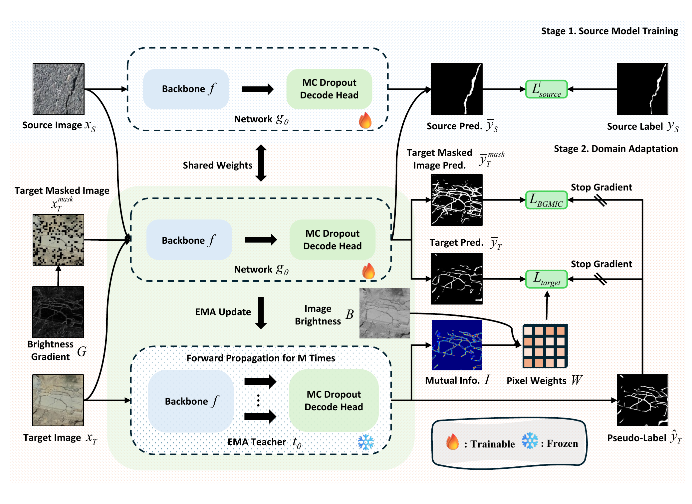

# BG-CrackDA

**Brightness-Guided Pseudo-Label Reweighting and Masked Image Consistency for Unsupervised Domain Adaptation in Crack Segmentation**

> **Paper status:** Submitted to *IEEE Transactions on Geoscience and Remote Sensing* (TGRS) on October 20, 2026.

  

## Overview

BG-CrackDA is a brightness-guided unsupervised domain adaptation framework for crack semantic segmentation. It is designed to reduce the performance degradation caused by domain shifts across crack datasets collected under different imaging conditions.

The framework combines a teacher--student self-training strategy with:

- uncertainty-aware pseudo-label denoising based on Monte Carlo dropout and mutual information;
- brightness-prior-guided pseudo-label reweighting using adaptive local reference regions; and
- brightness-gradient-guided masked image consistency for learning continuous crack structures from spatial context.

## Repository Status

The manuscript is currently under review. The complete source code, configuration files, pretrained weights, and reproduction instructions are not publicly available at this stage. They will be added to this repository in a future release. This placeholder release provides the project status and an overview of the proposed framework.

## Highlights

- Addresses unsupervised cross-domain crack segmentation without requiring target-domain annotations.
- Suppresses unreliable pseudo-labels through uncertainty estimation and confidence weighting.
- Uses crack-related brightness priors to refine pixel-level supervision.
- Improves structural consistency through brightness-gradient-guided masking.

## Citation

Citation information will be added after the paper is published.

## Contact

- Shaohui Yang: [shawnyang2001@foxmail.com](mailto:shawnyang2001@foxmail.com)
- Corresponding author, Fei Deng: [dengfei@cdut.edu.cn](mailto:dengfei@cdut.edu.cn)
